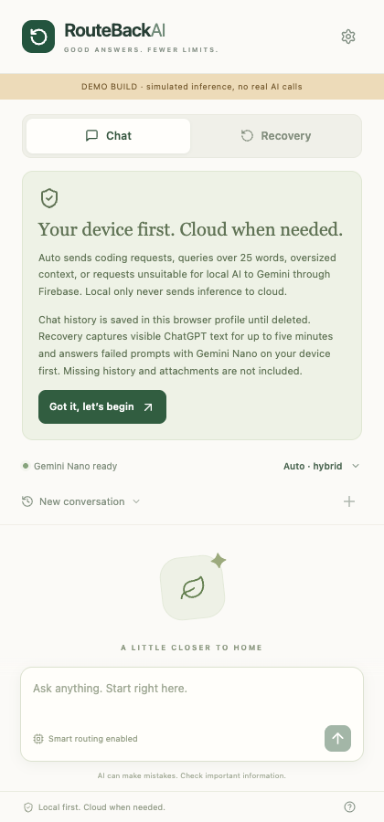
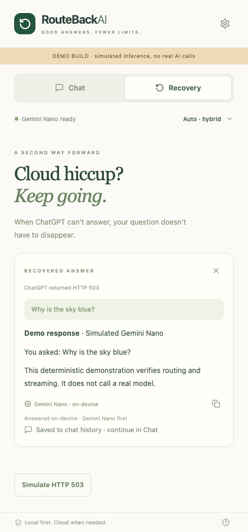
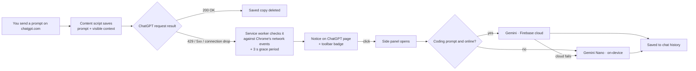

# RouteBackAI

**When cloud AI fails, keep going.**

RouteBackAI is a Chrome extension that catches a ChatGPT prompt when ChatGPT fails (a server error, a rate limit or a dropped connection) and answers it anyway with **Gemini Nano running on your device**. Coding prompts go to **Gemini in the cloud through Firebase** when you're online. It also includes a side-panel chat that uses on-device AI first and the cloud when needed.

Built on the **Firebase AI Logic hybrid inference SDK** and **Chrome's built-in Gemini Nano** (Prompt API).

| Chat (local-first) | ChatGPT recovery |
| :---: | :---: |
|  |  |

<sub>Screenshots are from the deterministic demo build (`npm run build:demo`), which shows a "DEMO BUILD" banner and simulated answers.</sub>

---

## The problem

When ChatGPT shows "Something went wrong", hits a rate limit, or your connection drops, the question you just typed is gone. You wait, retry, or copy it into another tool by hand. Meanwhile, recent Chrome versions ship a capable language model, Gemini Nano, that runs on your own machine.

## What RouteBackAI does

### 1. ChatGPT recovery
1. **It saves the prompt when you send it.** When you send a message on chatgpt.com, RouteBackAI keeps your prompt and the conversation visible on screen in memory for 5 minutes.
2. **It detects a failure.** HTTP **429** (rate limit), **500/502/503/504**, or a dropped connection on ChatGPT's request marks the prompt as failed. A short grace period lets ChatGPT's own retry succeed first.
3. **It offers an answer.** A small notice on the ChatGPT page shows the saved prompt with an **Answer with Gemini Nano** button, and the toolbar badge shows `!`.
4. **It answers.** One click opens the side panel and the answer streams in:
   - **Gemini Nano on-device** for most prompts, including when you're offline.
   - **Gemini through Firebase cloud** for coding prompts when you're online. If the cloud fails, it falls back to Nano.
5. **It keeps the answer.** The recovered prompt and answer are saved to chat history as a "Recovered · …" conversation, so you can continue it.

### 2. Local-first side-panel chat
A full chat in Chrome's side panel with saved, multi-turn history. Short everyday questions run on **Gemini Nano**. Coding requests, long prompts, or conversations too big for the device go to **Gemini in the cloud**. Every answer is labelled with where it actually ran.

---

## How it uses hybrid AI

All inference goes through **one SDK**, Firebase AI Logic (`firebase/ai`), using its three inference modes:

| Mode | Used for |
| --- | --- |
| `ONLY_ON_DEVICE` | Classifying a prompt (coding or not) with a JSON-schema-constrained Nano call. Also used for recovery answers and Local-only chat. |
| `PREFER_ON_DEVICE` | Short everyday chat questions: Nano when available, cloud if not. |
| `ONLY_IN_CLOUD` | Coding, long or oversized requests in Auto mode. |

- **Labels come from the SDK.** The "Gemini Nano · on-device" or "Gemini · Firebase cloud" label comes from the SDK's reported `inferenceSource`, not from the routing plan.
- **No secret keys in the extension.** Firebase holds the Gemini key; requests are protected by **Firebase App Check**. Chrome manages the Nano model itself.
- **Explicit guards stop silent cloud fallback.** The installed SDK can quietly dispatch an "on-device only" request to the cloud when Chrome's model is missing. The extension checks Nano's availability first so on-device-only calls never leave the device. Unit tests cover this.
- **Context is measured on the device.** Fit is checked with Chrome's own token measurement, keeping 2,048 tokens free for the answer.

### Routing at a glance

**Side-panel chat**

| Condition | Auto | Local only |
| --- | --- | --- |
| More than 25 words | Cloud | Blocked, with a hint to switch |
| Nano classifies it as coding | Cloud | Blocked, with a hint to switch |
| Conversation doesn't fit on-device | Cloud | Blocked, with a hint to switch |
| Nano can't classify it | Cloud | Blocked, with a hint to set up Nano |
| Short, non-coding, fits | Nano first, cloud if Nano unavailable | Nano only |

**ChatGPT recovery (Nano-first)**

| Condition | Auto, online | Auto, offline / Local only |
| --- | --- | --- |
| Coding prompt | Cloud, falls back to Nano | Nano |
| Any other prompt, any length | Nano | Nano |
| Too much context for Nano | Oldest messages dropped and the number disclosed; cloud only if even the bare prompt doesn't fit | Same, but never cloud |
| Nano not set up | Cloud | Error with setup hint |

### Recovery flow



---

## Try it

Requires **Node 24.12+** (see `.nvmrc`) and **Chrome 139+ on desktop**.

```sh
npm ci
```

### Option A: Demo build (no setup, about 1 minute)
```sh
npm run build:demo
```
1. Open `chrome://extensions`, turn on **Developer mode**, click **Load unpacked**, and select `dist-demo`.
2. Click the RouteBackAI toolbar icon to open the side panel.
3. Try the chat, then go to **Recovery** and click **Simulate HTTP 503**.

The demo uses a scripted, clearly labelled stand-in for the models. It shows routing, streaming and the recovery flow, but it is **not** real inference.

### Option B: Real build (Gemini Nano + Firebase cloud)

**1. Enable Gemini Nano in Chrome**
- Use Chrome 139+ on supported hardware.
- If needed, enable `chrome://flags/#prompt-api-for-gemini-nano-multimodal-input` and restart Chrome.
- After loading the extension, open **Settings → Set up** to download the model. It can take a few minutes.

**2. Set up Firebase** (needed for cloud routing)
1. In the [Firebase console](https://console.firebase.google.com), create a project and register a **Web app**.
2. Open **AI Logic → Get started** and choose the **Gemini Developer API**.
3. Open **App Check → Apps → your web app → Manage debug tokens** and generate a debug token.
4. Copy `.env.example` to `.env.local` and fill in the Web app config (`apiKey`, `projectId`, `appId`, `messagingSenderId`) and the debug token. Set `VITE_CLOUD_MODEL` to a model enabled in your project.

**3. Build and load**
```sh
npm run build:private
```
Load the **`dist-private`** folder as an unpacked extension. This build contains your App Check debug token, so **keep it private** and never commit or distribute it.

> Without Firebase setup, `npm run build` (folder `dist`) still works in **Local only** mode on Gemini Nano.

**4. Try ChatGPT recovery**
1. In the side panel, go to **Settings → ChatGPT recovery → Enable** and allow access to `chatgpt.com`.
2. Reload any open ChatGPT tabs.
3. To simulate a failure, open DevTools on the ChatGPT tab and set **Network → Offline**, then send a prompt.
4. After about 3 seconds, click **Answer with Gemini Nano** in the notice.

---

## Privacy and safety

- **Site access is opt-in and limited to `chatgpt.com`.** Standalone chat needs no site access.
- **Captured prompts expire after 5 minutes** and live in `chrome.storage.session` (memory only). They are cleared on success, dismissal, tab close, or when you disable recovery.
- **Recovery never touches ChatGPT's traffic.** It observes only the ChatGPT conversation request, never cookies or auth headers, and never changes or delays the request.
- **Captured text is limited.** Hidden elements, buttons, form fields and attachments are excluded from the captured context. Oversized captures are refused rather than cut down without notice.
- **Local only never sends a request to the cloud.** In Auto, the UI states why a prompt went to the cloud.
- **No analytics.** Rendered Markdown blocks remote images, and the extension's security policy limits network access to the Firebase AI Logic, App Check and Installations hosts.

More detail in [docs/PRIVACY.md](docs/PRIVACY.md).

---

## Testing

```sh
npm run check              # typecheck + unit tests + production build
npx playwright install chromium
npm run test:e2e           # builds, then drives the real extension in Chromium
```

- **47 unit tests** cover:
  - routing boundaries (25/26 words, coding, context fit)
  - Nano-first recovery and cloud fallback, including trimming context to fit
  - the real Firebase SDK's on-device path, run against a simulated Chrome model, plus the guards against silent cloud fallback
  - failure detection (429/5xx, network drops, 5-minute expiry, claiming and releasing a prompt)
  - chat storage, including migrating old saved chats
- **9 end-to-end tests** load the unpacked extension in a fresh Chromium profile against a controlled chatgpt.com fixture. They cover:
  - saved chat across panel reopen
  - cloud routing and Local-only blocking
  - 503 recovery that is saved to history
  - offline-style failure → notice click → recovery
  - confirmation mode
  - success clean-up

  They never touch your real Chrome profile.

The real-device and live-site checklist is in [docs/VALIDATION.md](docs/VALIDATION.md).

---

## Project structure

```
src/
  ai/provider.ts        Firebase AI Logic hybrid provider (classify, measure fit, stream)
  ai/recovery.ts        Nano-first recovery planner and cloud fallback
  ai/demo-provider.ts   Scripted stand-in model (demo build only)
  shared/routing.ts     Chat routing rules and prompt serialization
  shared/adapter.ts     ChatGPT endpoint allowlist + payload/message validation
  background/           Service worker: capture state, failure detection, badges, notices
  content/bridge.ts     Page script: captures submitted prompt + visible context
  content/observer.ts   Content script: relays captures, shows the in-page notice
  sidepanel/            React side-panel UI (chat, recovery, settings)
  storage/chats.ts      Per-conversation chat storage
tests/unit, tests/e2e   Vitest and Playwright suites
```

**Tech:** TypeScript, React 19, Vite + CRXJS (Manifest V3), Tailwind CSS 4, Firebase AI Logic (`firebase` 13.4.0), Chrome Prompt API, Vitest, Playwright.

---

## Known limitations

- **Live ChatGPT compatibility depends on ChatGPT's current page.** The extension relies on ChatGPT's current selectors and `/backend-api/(f/)conversation` request format. If ChatGPT changes them, the adapter needs updating. Recovery has been exercised manually on live ChatGPT; the automated tests use a fixture.
- **Text only, English-first.** Attachments and messages not loaded on the page are not captured.
- **No mid-answer recovery.** Errors that happen after ChatGPT has started streaming an answer are not detected.
- **Cloud requires a private build.** It uses an App Check **debug token**, and a public release would need production App Check attestation for extensions.
- **The panel needs one click to open.** Chrome only opens the side panel from a user click, which is why recovery uses the in-page button.

---

## References

- [Firebase AI Logic hybrid inference (Web)](https://firebase.google.com/docs/ai-logic/hybrid/web/get-started)
- [Inference modes and source attribution](https://firebase.google.com/docs/ai-logic/hybrid/web/configuration-options)
- [Chrome Prompt API](https://developer.chrome.com/docs/ai/prompt-api)
- [Chrome side panel API](https://developer.chrome.com/docs/extensions/reference/api/sidePanel)
- [Firebase App Check debug provider](https://firebase.google.com/docs/app-check/web/debug-provider)
